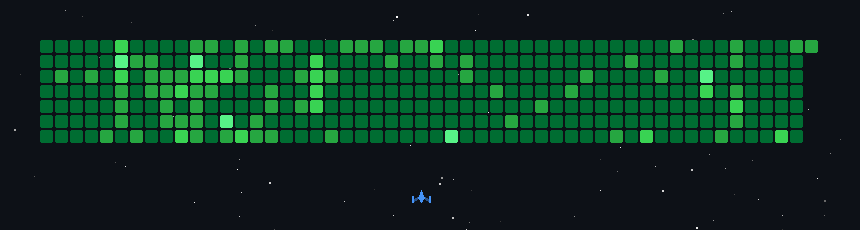

<!-- Generated by scripts/build_profile.py. Animated SVGs live in ./assets. -->

<a href="#about">About</a> &nbsp;·&nbsp; <a href="#stack">Stack</a> &nbsp;·&nbsp; <a href="#verified">Verified</a> &nbsp;·&nbsp; <a href="#projects">Projects</a> &nbsp;·&nbsp; <a href="#build-log">Build log</a> &nbsp;·&nbsp; <a href="#workflow">Workflow</a> &nbsp;·&nbsp; <a href="#activity">Activity</a> &nbsp;·&nbsp; <a href="#connect">Connect</a>

<b>Quick facts</b> &nbsp;(tap to expand: dated and verified)

- **Research Intern** · Machine Vision & Intelligence Lab, NIT Jamshedpur
- **B.Tech CSE** · CGPA 8.47 (May 2026)
- **Naukri Young Turks 2025** · 98.61 percentile, Rank 7,122
- **Hack Horizon 2.0** · 170+ teams, 750+ participants (2026)
- **80 public repositories** on GitHub (GitHub API, 05 Nov 2026)

## Projects

<table>
<thead><tr><th>Project</th><th>About</th><th>Stack</th><th>Links</th></tr></thead>
<tbody>
<tr>
<td><b>Community AI</b> <code>latest</code></td>
<td>Government schemes, learning and jobs, with AI help in 11 languages.

Read more
AI-powered community platform that gives access to government schemes, learning resources and job opportunities, with multilingual AI assistance in 11 languages.
</td>
<td><code>FastAPI</code> <code>React</code> <code>Groq&nbsp;+&nbsp;Gemini</code> <code>11&nbsp;languages</code> </td>
<td align="center"> </td>
</tr>
<tr>
<td><b>QuickFix</b></td>
<td>AI troubleshooting that turns problems into step-by-step fixes.

Read more
AI-powered troubleshooting platform that helps users identify technical problems and provides actionable, step-by-step solutions.
</td>
<td><code>AI&nbsp;troubleshooting</code> <code>step-by-step&nbsp;fixes</code> </td>
<td align="center"> </td>
</tr>
<tr>
<td><b>MobileNetV2 Defect Research</b></td>
<td>Steel defect classification with CAM-based localization.

Read more
Steel-surface defect classification with CAM-based localization: a MobileNetV2 backbone with FPN and attention fusion blocks, evaluated on NEU-DET and GC10-DET against baseline backbones, an FCOS-style detector and YOLO models.
</td>
<td><code>MobileNetV2</code> <code>FPN</code> <code>Grad-CAM</code> <code>NEU-DET&nbsp;+&nbsp;GC10-DET</code> </td>
<td align="center"></td>
</tr>
<tr>
<td><b>Steel Defect Detection</b></td>
<td>CNN-based detection and classification of steel surface defects.

Read more
Deep-learning computer vision system for detecting and classifying surface defects in steel using CNNs, MobileNetV2, FPN, and attention-based feature processing.
</td>
<td><code>CNNs</code> <code>MobileNetV2</code> <code>FPN</code> <code>attention</code> </td>
<td align="center"></td>
</tr>
<tr>
<td><b>JobPilot AI</b></td>
<td>Multi-agent assistant that finds entry-level jobs and applies for you.

Read more
Multi-agent system that finds entry-level jobs on Greenhouse and Lever, checks eligibility, picks the best of your own resumes and applies, emailing you anything it can't answer honestly.
</td>
<td><code>Multi-agent</code> <code>FastAPI</code> <code>React</code> <code>Playwright</code> </td>
<td align="center"></td>
</tr>
</tbody>
</table>

Tap <b>Read more</b> for details. Languages from the GitHub API, read 05 Nov 2026.

<kbd><a href="https://q7m2vx.vercel.app">Wind Forecast Monitor ↗</a></kbd> &nbsp;<kbd><a href="https://digital-dark-spot-tau.vercel.app">Digital Dark Spot ↗</a></kbd> &nbsp;<kbd><a href="https://vistara-x.vercel.app">VISTARA-X ↗</a></kbd> &nbsp;<kbd><a href="https://formpilot-six.vercel.app">FormPilot ↗</a></kbd> &nbsp;<kbd><a href="https://streamly-psi-six.vercel.app">Streamly ↗</a></kbd> &nbsp;<kbd><a href="https://nexus-rouge-five.vercel.app">NEXUS ↗</a></kbd>

## GitHub activity

  

  

<kbd><a href="https://linkedin.com/in/riteshkumar-tech">LinkedIn ↗</a></kbd> &nbsp;<kbd><a href="https://github.com/RiteshKumar2e">GitHub ↗</a></kbd> &nbsp;<kbd><a href="mailto:riteshkumar90359@gmail.com">Email ↗</a></kbd> &nbsp;<kbd><a href="https://riteshkr.info">Portfolio ↗</a></kbd>

<b>All links</b>

- **LinkedIn:** [linkedin.com/in/riteshkumar-tech](https://linkedin.com/in/riteshkumar-tech)
- **GitHub:** [github.com/RiteshKumar2e](https://github.com/RiteshKumar2e)
- **Email:** [riteshkumar90359@gmail.com](mailto:riteshkumar90359@gmail.com)
- **Portfolio:** [riteshkr.info](https://riteshkr.info)

