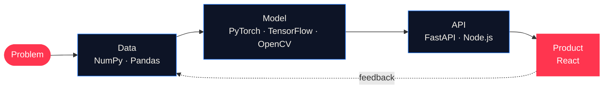

<!-- Generated by scripts/build_profile.py. Animated SVGs live in ./assets. -->

<a href="#about">About</a> &nbsp;·&nbsp; <a href="#stack">Stack</a> &nbsp;·&nbsp; <a href="#verified">Verified</a> &nbsp;·&nbsp; <a href="#projects">Projects</a> &nbsp;·&nbsp; <a href="#workflow">Workflow</a> &nbsp;·&nbsp; <a href="#activity">Activity</a> &nbsp;·&nbsp; <a href="#connect">Connect</a>

<b>Quick facts</b> &nbsp;(tap to expand: dated and verified)

- **Research Intern** · Machine Vision & Intelligence Lab, NIT Jamshedpur
- **B.Tech CSE** · CGPA 8.47 (May 2026)
- **Naukri Young Turks 2025** · 98.61 percentile, Rank 7,122
- **Hack Horizon 2.0** · 170+ teams, 750+ participants (2026)
- **80 public repositories** on GitHub (GitHub API, 01 Nov 2026)

## Projects

Tap a project to expand it. Languages from the GitHub API, read 01 Nov 2026.

<b>Community AI</b> &nbsp;<code>latest</code> &nbsp;JavaScript · FastAPI · React · Groq + Gemini · 11 languages

> AI-powered community platform that gives access to government schemes, learning resources and job opportunities, with multilingual AI assistance in 11 languages.

<kbd><a href="https://github.com/RiteshKumar2e/Community-Empowering-2.0">Repository ↗</a></kbd> &nbsp;<kbd><a href="https://communityai.co.in">Live demo ↗</a></kbd>

<b>QuickFix</b> &nbsp;Python · AI troubleshooting · step-by-step fixes

> AI-powered troubleshooting platform that helps users identify technical problems and provides actionable, step-by-step solutions.

<kbd><a href="https://github.com/RiteshKumar2e/customer-complaint-agent_new">Repository ↗</a></kbd> &nbsp;<kbd><a href="https://riteshkr.online">Live demo ↗</a></kbd>

<b>MobileNetV2 Defect Research</b> &nbsp;Jupyter Notebook · MobileNetV2 · FPN · Grad-CAM · NEU-DET + GC10-DET

> Steel-surface defect classification with CAM-based localization: a MobileNetV2 backbone with FPN and attention fusion blocks, evaluated on NEU-DET and GC10-DET against baseline backbones, an FCOS-style detector and YOLO models.

<kbd><a href="https://github.com/RiteshKumar2e/MobileNetV2">Repository ↗</a></kbd>

<b>Steel Defect Detection</b> &nbsp;Jupyter Notebook · CNNs · MobileNetV2 · FPN · attention

> Deep-learning computer vision system for detecting and classifying surface defects in steel using CNNs, MobileNetV2, FPN, and attention-based feature processing.

<kbd><a href="https://github.com/RiteshKumar2e/Steel_Surface_Defect_NEU_DET-DATASET">Repository ↗</a></kbd>

<b>JobPilot AI</b> &nbsp;Python · Multi-agent · FastAPI · React · Playwright

> Multi-agent system that finds entry-level jobs on Greenhouse and Lever, checks eligibility, picks the best of your own resumes and applies, emailing you anything it can't answer honestly.

<kbd><a href="https://github.com/RiteshKumar2e/jobpilot">Repository ↗</a></kbd>

<a href="#top">back to top ↑</a>

## From problem to product

## GitHub activity

  

  

<a href="#top">back to top ↑</a>

<kbd><a href="https://linkedin.com/in/riteshkumar-tech">LinkedIn ↗</a></kbd> &nbsp;<kbd><a href="https://github.com/RiteshKumar2e">GitHub ↗</a></kbd> &nbsp;<kbd><a href="mailto:riteshkumar90359@gmail.com">Email ↗</a></kbd> &nbsp;<kbd><a href="https://riteshkr.info">Portfolio ↗</a></kbd>

<b>All links</b>

- **LinkedIn:** [linkedin.com/in/riteshkumar-tech](https://linkedin.com/in/riteshkumar-tech)
- **GitHub:** [github.com/RiteshKumar2e](https://github.com/RiteshKumar2e)
- **Email:** [riteshkumar90359@gmail.com](mailto:riteshkumar90359@gmail.com)
- **Portfolio:** [riteshkr.info](https://riteshkr.info)

<a href="#top">back to top ↑</a>

